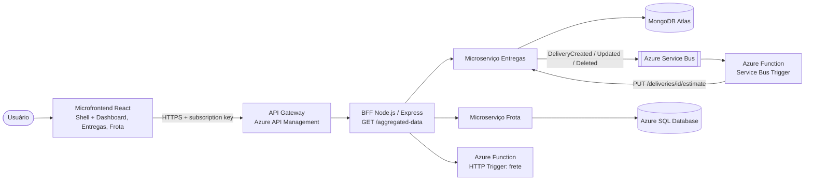

# CloudLog · Azure Function - frete, prazo e eventos

Projeto PJBL da disciplina **Arquitetura de Software e Soluções Cloud** (PUCPR) - Prof. Manoel Valerio da Silveira Neto.

## Alunos

- Camilla Augusta Uber
- João Davi
- Laura Guillarducci

## Sobre

Function App (Azure Functions v4, Node.js) com duas functions:

- **`calcularFrete` (HTTP Trigger)** - `GET/POST /api/frete`: calcula frete e prazo (com as pausas obrigatórias do motorista da Lei 13.103/2015). Aceita um item ou uma lista (o BFF usa em lote).
- **`processarEventoEntrega` (Service Bus Trigger / Message Trigger)** - consome a fila `cloudlog-entregas-eventos`, calcula a estimativa e grava no Microserviço de Entregas (enriquecimento de dados).

## Arquitetura da solução



| Projeto | Repositório |
|---|---|
| Microfrontend (React) | [cloudlog-frontend](https://github.com/laducci/cloudlog-frontend) |
| BFF (Node.js/Express) | [cloudlog-bff](https://github.com/laducci/cloudlog-bff) |
| Microserviço de Entregas (MongoDB) | [cloudlog-entregas-service](https://github.com/laducci/cloudlog-entregas-service) |
| Microserviço de Frota (Azure SQL) | [cloudlog-frota-service](https://github.com/laducci/cloudlog-frota-service) |
| Azure Function (frete + eventos) | [cloudlog-function](https://github.com/laducci/cloudlog-function) |

### Clean Architecture + Vertical Slice

```
src/
├── Domain/          entidades, regras de negócio, erros e portas (interfaces) - sem dependências externas
├── Application/
│   └── Features/    uma pasta por caso de uso (Vertical Slice)
│       ├── CalculateFreight/
│       └── ProcessDeliveryEvent/
├── Infrastructure/  adaptadores concretos (banco, mensageria, HTTP) que implementam as portas do Domain
└── API/             camada de entrada (Express/Functions), Swagger e Composition Root
```

Regra de dependência (verificada pelos testes de arquitetura com **ArchUnitTS**):
`API → Application → Domain` e `Infrastructure → Domain`. O Domain não conhece nenhuma outra camada,
a Application não conhece Infrastructure nem API, e uma feature não importa outra feature.

## Tabela de frete (domínio)

| Item | Valor |
|---|---|
| Taxa base | R$ 120,00 |
| Por km | R$ 2,35 |
| Por kg·km | R$ 0,00025 |
| Pedágio | R$ 18,40 a cada 100 km |
| Velocidade média | 62 km/h + 1,5 h de carga/descarga |
| Pausa | 30 min a cada 5h30 de direção |
| Nível de serviço | Expresso (≤ 150 km), Padrão (≤ 600 km), Longa distância |

## Tecnologias

- Node.js 22 + TypeScript
- Vitest (testes unitários) + ArchUnitTS (testes de arquitetura)
- Azure Functions v4 (modelo de programação Node v4, `@azure/functions`)
- Azure Service Bus (trigger de fila)

## Endereços na nuvem

| Recurso | URL |
|---|---|
| Frontend (microfrontend) | https://stcloudlogweba6058.z15.web.core.windows.net |
| API Gateway (Azure API Management) | https://apim-cloudlog-a6058.azure-api.net/cloudlog/aggregated-data (header `Ocp-Apim-Subscription-Key`) |
| BFF · Swagger | https://ca-cloudlog-bff.delightfulbeach-476aeb68.brazilsouth.azurecontainerapps.io/docs |
| Microserviço Entregas · Swagger | https://ca-cloudlog-entregas.delightfulbeach-476aeb68.brazilsouth.azurecontainerapps.io/docs |
| Eventos (AsyncAPI) | https://ca-cloudlog-entregas.delightfulbeach-476aeb68.brazilsouth.azurecontainerapps.io/events/docs |
| Microserviço Frota · Swagger | https://ca-cloudlog-frota.delightfulbeach-476aeb68.brazilsouth.azurecontainerapps.io/docs |
| Azure Function · Swagger | https://func-cloudlog-a6058.azurewebsites.net/api/docs |
| Docker Hub | https://hub.docker.com/u/laducci |

## Como rodar localmente

Requer [Azure Functions Core Tools](https://learn.microsoft.com/azure/azure-functions/functions-run-local).

```bash
npm install
cp local.settings.example.json local.settings.json   # ajuste as variáveis
npm start                                            # build + func start
# http://localhost:7071/api/frete?distanceKm=130&weightKg=850
# http://localhost:7071/api/docs  (Swagger)
```

Pacote para publicar no Azure: `npm run package` gera `cloudlog-function.zip`
(`az functionapp deployment source config-zip -g <rg> -n <app> --src cloudlog-function.zip`).

## Testes

```bash
npm run test:arch   # testes de arquitetura (ArchUnitTS)
npm run test:unit   # testes unitários
npm test            # todos
```
